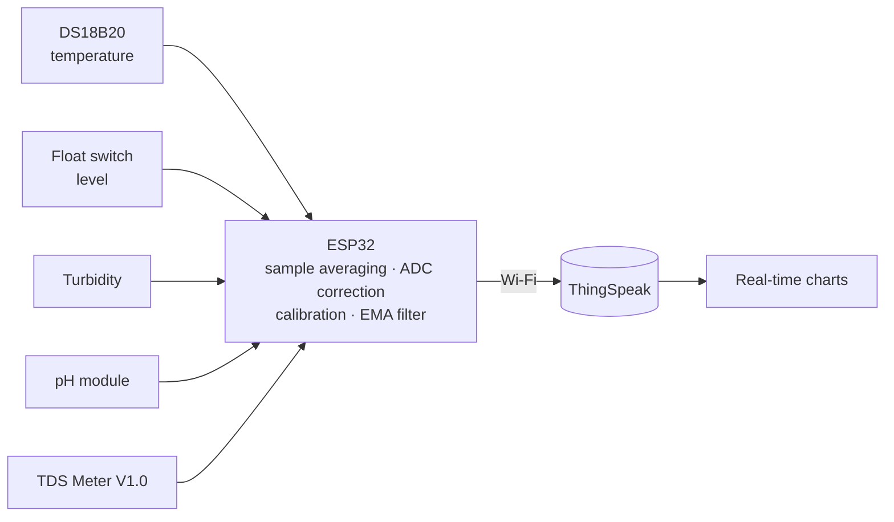

# 🐟 Water Quality Monitoring for Aquaculture


[🇧🇷 Português](README.md) · 🇺🇸 English

Firmware and hardware from my Control and Automation Engineering thesis (UTFPR, 2025): a **low-cost IoT system** that continuously measures water temperature, level, turbidity, pH and total dissolved solids (TDS) and sends the data to the cloud. It was validated in laboratory tanks (a "miniworld") and in a real lake.

<p align="center">
  
</p>

## Overview



## What the firmware does

- **20-sample averaging** per analog reading, with **ESP32 ADC non-linearity correction** (factor measured against a multimeter: 2.31 V / 2.058 V ≈ 1.1224).
- **Temperature-compensated pH**: electrode sensitivity is scaled by `298.15 K / T`.
- **TDS compensated to 25 °C** (2 %/°C) from conductivity.
- **Exponential moving average (EMA) filter** on turbidity, pH and TDS to smooth noise.
- **Non-blocking timing** (`millis()`), **Wi-Fi connection timeout** and **automatic reconnection**: if the network drops, the device keeps measuring.
- **Credentials kept out of the code**: they live in `secrets.h`, which Git ignores.

## Hardware

| Sensor | GPIO | Notes |
|---|---|---|
| DS18B20 (temperature) | 4 | OneWire, 10 kΩ pull-up |
| Float switch (level) | 25 | `INPUT_PULLUP`, `LOW` = full |
| Turbidity | 32 | ADC1 |
| pH | 33 | ADC1, conditioning module powered at 3.3 V |
| TDS Meter V1.0 | 35 | ADC1 |

Analog sensors use **ADC1**, which stays usable while Wi-Fi is on (ADC2 does not).
Schematic: [`hardware/esquematico_tcc.kicad_sch`](hardware/esquematico_tcc.kicad_sch) (KiCad 9):

<p align="center">
  
</p>

**Prototype cost: R$ 328.49**: pH R$ 128.90 · turbidity R$ 100.00 · ESP32 R$ 30.00 · TDS R$ 31.49 · level R$ 24.90 · temperature R$ 13.20.

## Getting started

1. Install the [Arduino IDE](https://www.arduino.cc/en/software) with the **ESP32** board package (Espressif).
2. Install the **ThingSpeak**, **OneWire** and **DallasTemperature** libraries.
3. Create a [ThingSpeak](https://thingspeak.com) channel with 5 fields:

   | Field | Content |
   |---|---|
   | 1 | Temperature (°C) |
   | 2 | Level (1 = full, 0 = empty) |
   | 3 | Turbidity (%) |
   | 4 | pH |
   | 5 | TDS (ppm) |

4. In `firmware/tcc_monitoramento_agua/`, copy `secrets.h.example` to `secrets.h` and fill in your Wi-Fi, channel ID and *Write API Key*.
5. Open `tcc_monitoramento_agua.ino`, select **ESP32 Dev Module** and upload. Serial monitor: 115200 baud.

### Calibration

Values live in [`config.h`](firmware/tcc_monitoramento_agua/config.h). The pH values were obtained with **pH 4.01, 6.86 and 9.18** buffer solutions after setting the module offset to ≈ 2.5 V. **Recalibrate** for your own electrode and module. The sketches in `firmware/testes_sensores/` help validate each sensor on its own.

## Results

| Scenario | Temp. | Turbidity | pH | TDS |
|---|---|---|---|---|
| Tank A (organic matter, acidic) | ≈ 22 °C | 39 % | 3.65 | 562 ppm |
| Tank B (saline, basic) | ≈ 24 °C | 22 % | 8.44 | 1075 ppm |
| Lake (field, 30 s sampling) | ≈ 22 °C | 48 % | ≈ 8.0 (manual: ≈ 8.6) | 458 ppm |

The system clearly distinguished the two miniworld scenarios and logged values consistent with the manual measurement at the lake.

<p align="center">
  
</p>

**Limitations:** pH needs frequent calibration (electrode drift), turbidity is a relative scale (%), and TDS is affected by temperature. Operation depends on Wi-Fi.

## Structure

```
├── firmware/
│   ├── tcc_monitoramento_agua/   # main firmware (.ino + config.h + secrets.h.example)
│   └── testes_sensores/          # one test sketch per sensor
├── hardware/                     # KiCad schematic
└── docs/images/
```

## Next steps

Predictive AI analysis on the collected data, closed-loop control (aerators and pumps) and long-range communication with LoRa.

## About the thesis

**Automation of water quality analysis and control in tilapia aquaculture: validation with miniworld and IoT technology.** Tabita Ester Mittanck Tavares, advisor Prof. Dr. Wesley Angelino de Souza. UTFPR, Cornélio Procópio campus, 2025 (written in Portuguese).

## License

Code released under the [MIT license](LICENSE).
