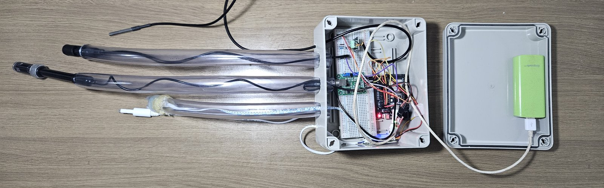
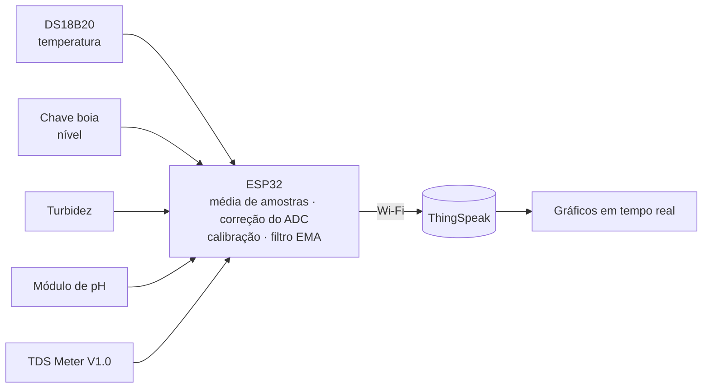
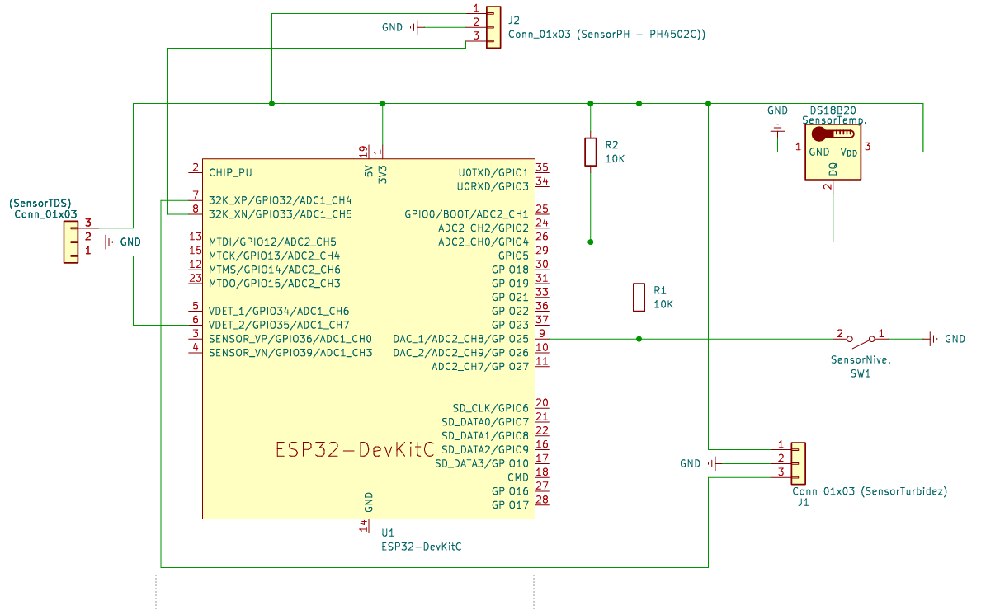
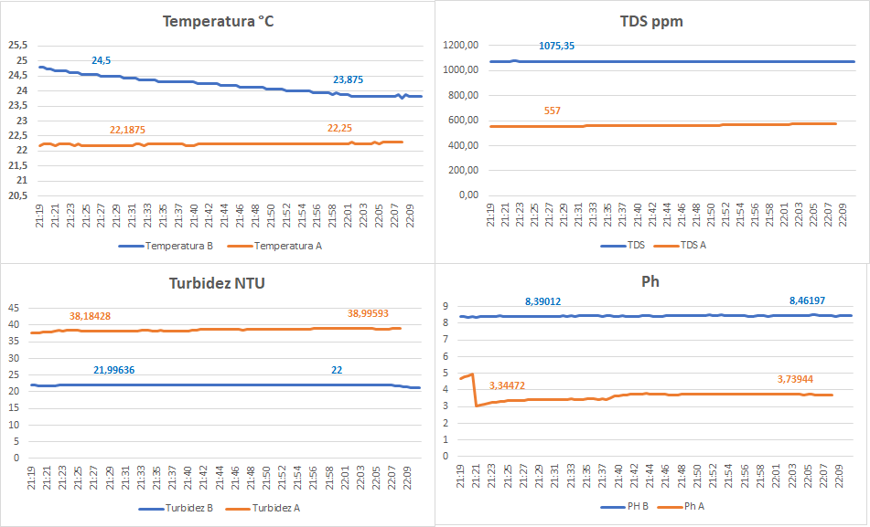

# 🐟 Monitoramento da Qualidade da Água em Piscicultura


🇧🇷 Português · [🇺🇸 English](README.en.md)

Firmware e hardware do meu TCC em Engenharia de Controle e Automação (UTFPR, 2025): um sistema **IoT de baixo custo** que mede continuamente temperatura, nível, turbidez, pH e sólidos dissolvidos (TDS) da água e envia os dados para a nuvem. Foi validado em tanques de laboratório (minimundo) e em um lago real.

<p align="center">
  
</p>

## Visão geral



## O que o firmware faz

- **Média de 20 amostras** por leitura analógica, com **correção da não linearidade do ADC** do ESP32 (fator medido contra multímetro: 2,31 V / 2,058 V ≈ 1,1224).
- **pH com compensação de temperatura**: a sensibilidade do eletrodo é corrigida por `298,15 K / T`.
- **TDS compensado para 25 °C** (coeficiente de 2 %/°C) a partir da condutividade.
- **Filtro de média móvel exponencial (EMA)** em turbidez, pH e TDS para suavizar o ruído.
- **Temporização sem `delay` longo** (`millis()`), **timeout na conexão Wi-Fi** e **reconexão automática**: se a rede cair, o sistema continua medindo.
- **Credenciais fora do código**: ficam em `secrets.h`, ignorado pelo Git.

## Hardware

| Sensor | GPIO | Observação |
|---|---|---|
| DS18B20 (temperatura) | 4 | OneWire, pull-up de 10 kΩ |
| Chave boia (nível) | 25 | `INPUT_PULLUP`, `LOW` = cheio |
| Turbidez | 32 | ADC1 |
| pH | 33 | ADC1, módulo condicionador alimentado com 3,3 V |
| TDS Meter V1.0 | 35 | ADC1 |

Os sensores analógicos ficam no **ADC1**, que continua utilizável com o Wi-Fi ligado (o ADC2 não é).
Esquemático em [`hardware/esquematico_tcc.kicad_sch`](hardware/esquematico_tcc.kicad_sch) (KiCad 9):

<p align="center">
  
</p>

**Custo do protótipo: R$ 328,49** (pH R$ 128,90 · turbidez R$ 100,00 · ESP32 R$ 30,00 · TDS R$ 31,49 · nível R$ 24,90 · temperatura R$ 13,20).

## Como rodar

1. Instale o [Arduino IDE](https://www.arduino.cc/en/software) com o pacote de placas **ESP32** (Espressif).
2. Instale as bibliotecas **ThingSpeak**, **OneWire** e **DallasTemperature**.
3. Crie um canal no [ThingSpeak](https://thingspeak.com) com 5 campos:

   | Campo | Conteúdo |
   |---|---|
   | 1 | Temperatura (°C) |
   | 2 | Nível (1 = cheio, 0 = vazio) |
   | 3 | Turbidez (%) |
   | 4 | pH |
   | 5 | TDS (ppm) |

4. Em `firmware/tcc_monitoramento_agua/`, copie `secrets.h.example` para `secrets.h` e preencha Wi-Fi, ID do canal e *Write API Key*.
5. Abra `tcc_monitoramento_agua.ino`, selecione a placa **ESP32 Dev Module** e faça o upload. Monitor serial: 115200 baud.

### Calibração

Os valores ficam em [`config.h`](firmware/tcc_monitoramento_agua/config.h). Os de pH foram obtidos com soluções tampão de **pH 4,01, 6,86 e 9,18**, depois de ajustar o offset do módulo para ≈ 2,5 V. **Refaça a calibração** com o seu eletrodo e o seu módulo. Os sketches de `firmware/testes_sensores/` ajudam a validar cada sensor separadamente.

## Resultados

| Cenário | Temp. | Turbidez | pH | TDS |
|---|---|---|---|---|
| Tanque A (matéria orgânica, ácido) | ≈ 22 °C | 39 % | 3,65 | 562 ppm |
| Tanque B (salino, básico) | ≈ 24 °C | 22 % | 8,44 | 1075 ppm |
| Lago (campo, 30 s de amostragem) | ≈ 22 °C | 48 % | ≈ 8,0 (manual: ≈ 8,6) | 458 ppm |

O sistema distinguiu claramente os dois cenários do minimundo e registrou valores coerentes com a medição manual no lago.

<p align="center">
  
</p>

**Limitações:** o pH exige calibração frequente (deriva do eletrodo), a turbidez é uma escala relativa (%) e o TDS sofre influência da temperatura. A operação depende de Wi-Fi.

## Estrutura

```
├── firmware/
│   ├── tcc_monitoramento_agua/   # firmware principal (.ino + config.h + secrets.h.example)
│   └── testes_sensores/          # um sketch de teste por sensor
├── hardware/                     # esquemático KiCad
└── docs/images/
```

## Próximos passos

Análise preditiva com IA sobre os dados coletados, controle em malha fechada (aeradores e bombas) e comunicação de longo alcance com LoRa.

## Sobre o trabalho

**Automatização da análise e controle da qualidade da água em piscicultura de tilápia: validação com minimundo e tecnologia IoT.** Tabita Ester Mittanck Tavares, orientador Prof. Dr. Wesley Angelino de Souza. UTFPR, Câmpus Cornélio Procópio, 2025.

## Licença

Código sob licença [MIT](LICENSE).
